# Overlap

Add people with their time zones, see each person's day on one shared axis, find the best call windows and share the chosen slot. A React Native app for Android and iOS, in English, Ukrainian and Spanish.

## Screens

| | Timeline | Slot | Edit person |
| --- | --- | --- | --- |
| Dark | 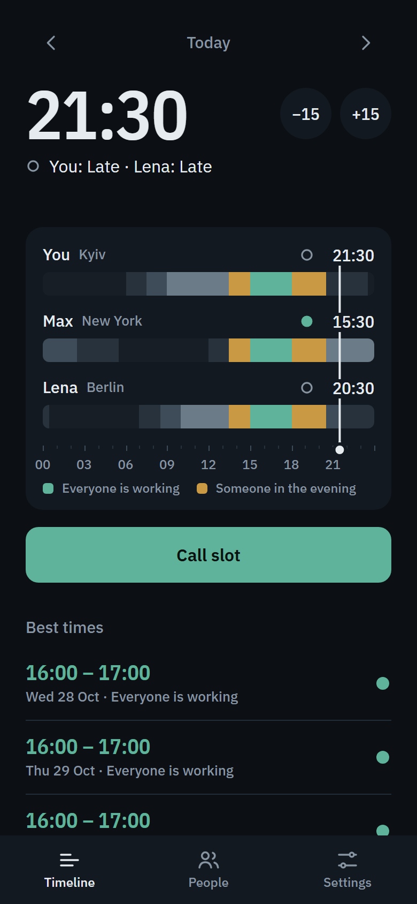 | 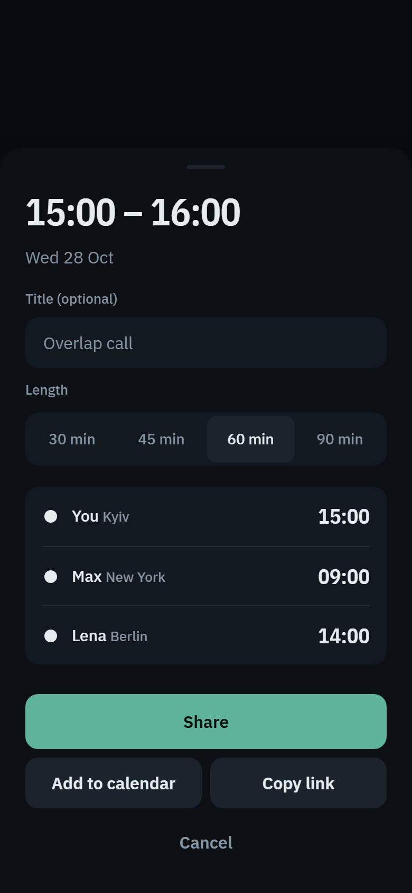 | 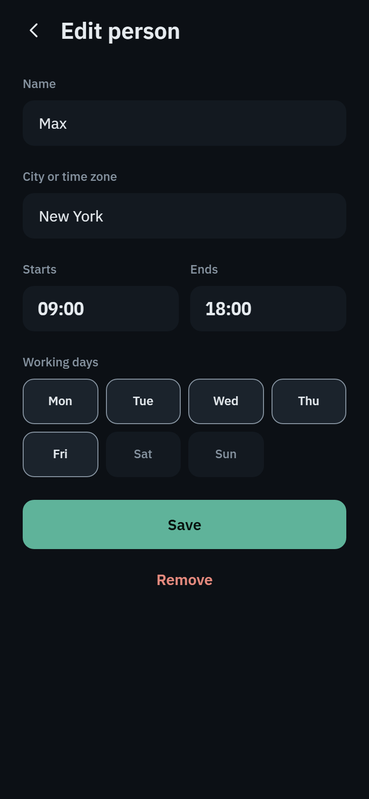 |
| Light | 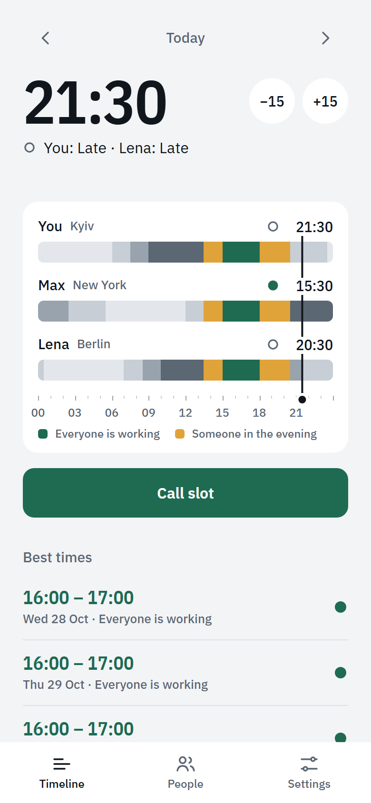 | 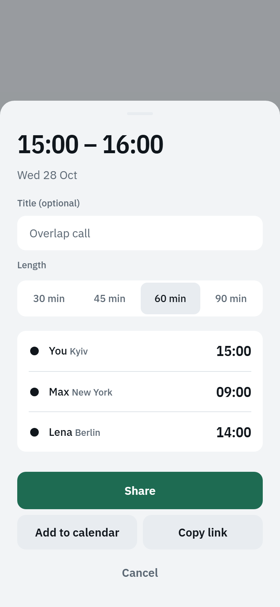 | 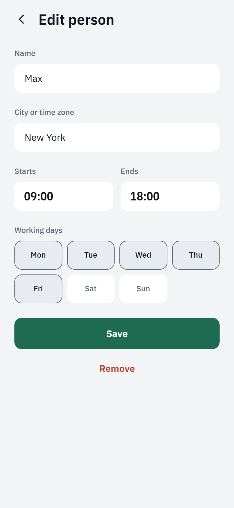 |

| | People | Settings | Slot page on the web |
| --- | --- | --- | --- |
| Dark | 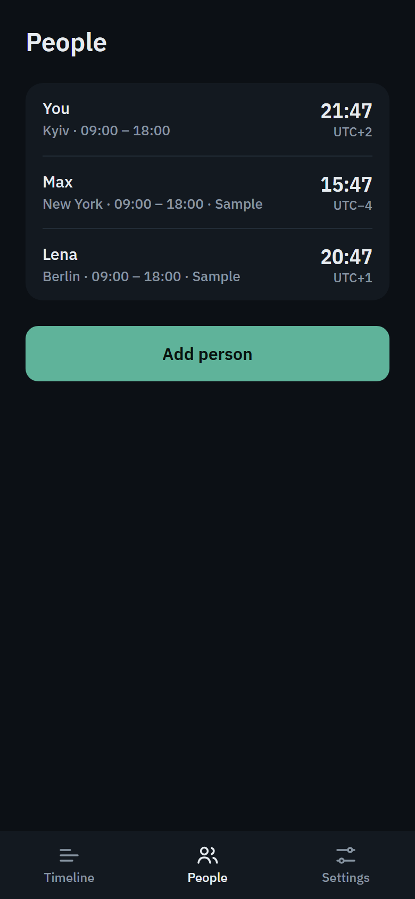 | 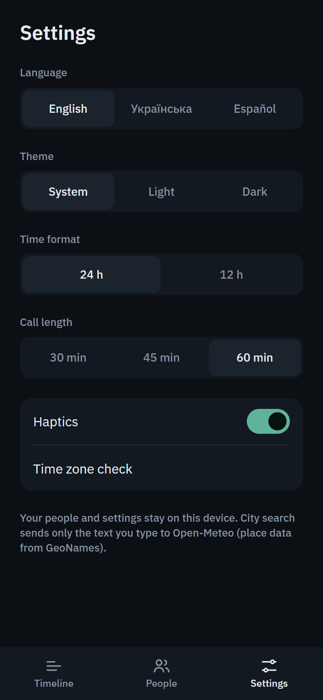 | 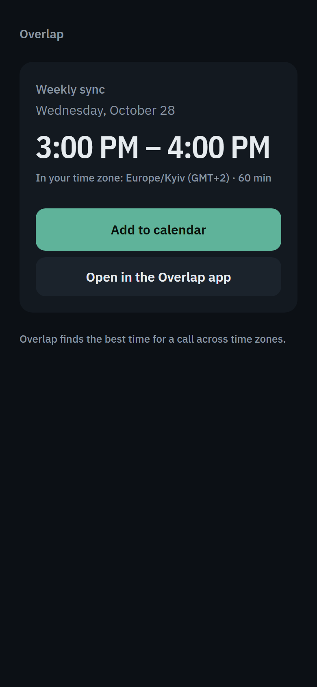 |
| Light | 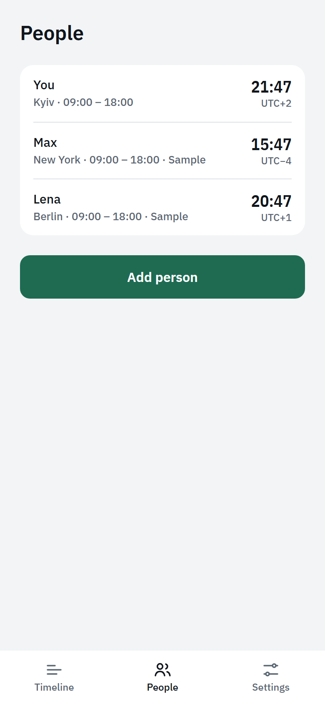 | 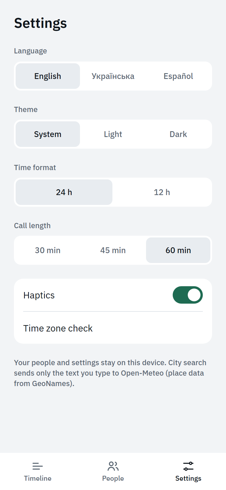 | 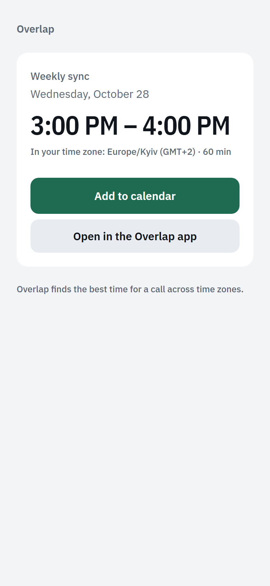 |

## Features

- **One shared axis.** Everyone's working hours, evenings, late hours and sleep on a single day, with a cursor to pick the time.
- **Best times.** The three most comfortable slots in the next seven days, scored so that a time that suits everyone beats one that is perfect for one person.
- **Clock change notices.** A heads-up when daylight saving moves a call for someone.
- **Groups.** Keep people in named groups, for example one per client.
- **Weekly calls.** Save a slot as a weekly call with an optional reminder.
- **Share.** Send a slot as text or a link, or add it to the calendar.
- **Light and dark themes**, following the device by default.

## Credits

City search uses the [Open-Meteo geocoding API](https://open-meteo.com/en/docs/geocoding-api), with place data from [GeoNames](https://www.geonames.org/). Only the text typed in the search field is sent.
